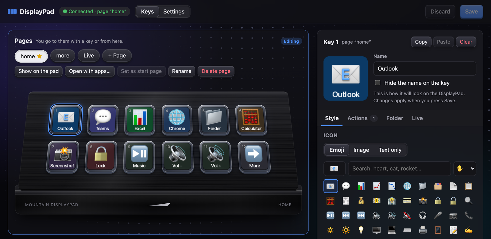
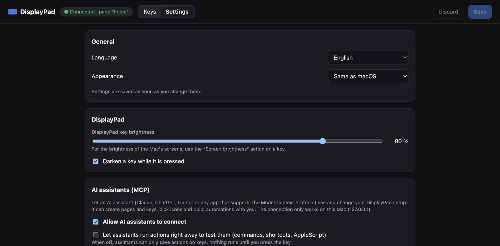

# DisplayPad for Mac

Usa el **Mountain DisplayPad** (USB `3282:0009`) en macOS sin BaseCamp: una imagen o
animación en cada una de las 12 teclas, varias páginas y una o varias acciones por tecla
(abrir apps, atajos de teclado, texto, teclas multimedia, macros, scripts, brillo de las
pantallas). Funciona como un servicio en segundo plano, con un **configurador gráfico**
en el navegador y un **servidor MCP** opcional para que un asistente de IA te ayude a
configurar tus teclas.

[English](README.md)



> **Hecho con IA.** Este proyecto se escribió con [Claude Code](https://claude.com/claude-code)
> (el asistente de programación con IA de Anthropic), dirigido y probado por una persona en
> un DisplayPad real. Ver [Hecho con IA](#hecho-con-ia).

## Funciones

- **12 teclas con imagen:** emoji, PNG/JPG, GIF/WebP/APNG animado o **Lottie**
  (`.json`, `.lottie`, `.tgs`), con texto, colores y tamaño del ícono de 30 % a 200 %.
  Puedes **ocultar el texto de una tecla** sin borrarlo.
- **Las imágenes nunca se estiran:** las teclas son cuadradas, así que una imagen ancha o
  alta abre un editor de encuadre donde la mueves y la acercas para elegir la parte que
  muestra la tecla, o la muestras completa. Funciona igual con GIF y Lottie.
- **Carpetas:** cualquier tecla puede ser una carpeta con 11 teclas más, y puedes poner
  carpetas dentro de carpetas. La tecla 1 de una carpeta siempre te lleva atrás.
- **Páginas:** todas las que quieras, con tecla «Volver» y página inicial.
- **Acciones:** abrir una app, web o carpeta; atajos de teclado; escribir texto;
  reproducir/pausar, volumen y otras teclas multimedia; comandos de terminal; AppleScript;
  cambiar de página; brillo de las pantallas del Mac (la integrada y las externas por
  DDC/CI) y del pad; pausas entre acciones. Varias acciones por tecla, en orden.
- **Macros:** graba lo que haces con el teclado y el mouse (teclas, clics, arrastres,
  desplazamiento), edita los pasos y las esperas, y reprodúcelo desde una tecla una vez,
  varias veces, mientras mantienes la tecla, o encendido y apagado con cada pulsación.
- **Configurador:** arrastra teclas para intercambiarlas, suelta imágenes sobre ellas,
  graba atajos (una sola tecla, o los modificadores izquierdo y derecho por separado) o
  elígelos en un teclado en pantalla, y prueba las acciones antes de guardar. En inglés y español, claro y oscuro.
- **Asistentes de IA (MCP):** Claude, Cursor, VS Code o cualquier app MCP de tu Mac puede
  leer y cambiar tu configuración si lo permites. Desactivado por defecto.
- **Servicio:** arranca al iniciar sesión, se reconecta solo después de dormir el Mac o
  desconectar el pad, y recarga la configuración en cuanto cambia.

## Requisitos

- macOS. Probado en macOS 27.2 con Apple Silicon; en Mac con Intel debería funcionar,
  pero no se ha probado.
- [Homebrew](https://brew.sh) y Python 3.11 o superior (`brew install python@3.14`).
- Si falta `libusb`, el instalador lo instala con Homebrew.

## Instalación

Descarga el zip de la [última versión](../../releases/latest) y descomprímelo, o clona el
repositorio. Luego, en Terminal:

```bash
cd displaypad-mac
./install.sh
```

El instalador:

- copia el programa a `~/Library/Application Support/DisplayPadMac/`;
- prepara su entorno de Python;
- registra un servicio que arranca al iniciar sesión y se reinicia si falla
  (`~/Library/LaunchAgents/com.displaypadmac.agent.plist`);
- agrega la app **DisplayPad** a Aplicaciones. Abre el configurador.

Vuelve a ejecutar `./install.sh` para actualizar. Tu configuración se conserva.

### Permisos

macOS pide dos permisos para **Python**. El instalador muestra la ruta del `Python.app`
que los necesita.

- **Monitoreo de entrada:** sin él, el servicio no puede activar el DisplayPad.
- **Accesibilidad:** lo necesitan las acciones de atajo, texto, teclas multimedia y macro.

Si macOS no lo pide, abre *Ajustes del Sistema → Privacidad y seguridad*, abre la
sección, pulsa **+** y elige ese `Python.app`. Después pulsa **Restart service**
(Reiniciar servicio) en el configurador.

### Desinstalar

```bash
./uninstall.sh
```

Agrega `--all` para borrar también tu configuración e imágenes.

## El configurador

Ábrelo con la app **DisplayPad** (Aplicaciones, Launchpad o Spotlight), con la tecla
**⚙️ Configure** del pad o con `python -m displaypad_mac configure`.

El idioma por defecto es inglés: cámbialo a español en **Settings → Language**.

- **Páginas:** pestañas arriba. Crea, renombra y elimina páginas, marca la página inicial
  (★) o muéstrala en el pad.
- **Teclas:** haz clic en una para editarla. Arrastra una tecla sobre otra para
  intercambiarlas, o suelta una imagen sobre ella. Copia y pega teclas entre páginas.
- **Carpetas:** en el editor de la tecla, **Convertir esta tecla en carpeta** y luego
  **Abrir carpeta ›** (o doble clic en la tecla). Dentro, la tecla 1 es una tecla
  **Volver** fija y la ruta de arriba (`inicio › Trabajo`) te lleva hacia arriba. Para
  mover una tecla a una carpeta, arrástrala y mantenla sobre la carpeta hasta que se abra,
  y suéltala donde quieras. Igual con **Volver**, un paso de la ruta o la pestaña de una
  página; si la sueltas justo encima, va a la primera tecla libre de ahí. En el pad, al
  pulsar una tecla carpeta se abre.
- **Apariencia:** emoji (con paleta rápida), imagen o solo texto; texto, colores y tamaño
  del ícono. Marca **Ocultar el texto en la tecla** para conservar el texto sin dibujarlo.
  La vista previa es exactamente lo que dibuja el pad.
- **Ajustar encuadre:** al añadir una imagen o animación que no es cuadrada, se abre una
  ventana donde la arrastras y la acercas o alejas (control, rueda del mouse, pellizco en
  el trackpad, o flechas y + / −) dentro de un cuadrado del tamaño de la tecla. **Imagen
  completa** la muestra entera con el color de la tecla alrededor; **Llenar la tecla**
  cubre la tecla con su centro. La imagen mantiene sus proporciones y el archivo original
  no cambia, así que puedes volver a encuadrarla con **Ajustar encuadre…** en la pestaña
  Imagen.
- **Acciones:** varias por tecla, en orden. **Grabar** captura las teclas que pulses: una
  combinación como ⌘⇧4, una sola tecla como F13 o un modificador solo, y distingue la
  izquierda de la derecha (⌘ derecho se guarda como `rcmd`). **Teclado…** abre un teclado
  en pantalla para elegir las teclas con el mouse, para las que el navegador se reserva
  (⌘Q, ⌘W, fn) y para el teclado numérico. **Mantener las teclas pulsadas mientras
  mantienes la tecla del pad** sirve para apps que reaccionan a una tecla mantenida, como
  el dictado de pulsar para hablar. **▶ Probar** ejecuta las acciones y muestra la salida o el error de los comandos
  de terminal y AppleScript.
- **Macros:** agrega una acción **Macro (teclado y mouse)** y pulsa **● Grabar…**. Elige
  qué grabar (el teclado; los clics, arrastres y desplazamiento del mouse; y el movimiento
  del puntero si lo necesitas) y pulsa **Empezar a grabar**: tienes 3 segundos para
  cambiar a tu app. Haz lo que debe hacer la macro y luego pulsa cualquier tecla del
  DisplayPad (o **Detener** en el configurador). **Editar pasos…** muestra cada paso:
  cambia teclas, botones, posiciones y esperas, agrega o mueve pasos, o pon la misma
  espera en todo. **Reproducción** la reproduce una vez, varias veces, mientras mantienes
  la tecla del pad o de una pulsación a la siguiente; **Esperas** mantiene las grabadas,
  usa una espera fija o ninguna. **▶ Probar** la reproduce una vez a los 3 segundos, y
  mientras una macro se reproduce aparece un aviso con **Detener**.
- **Guardar** (⌘S) revisa todo antes y te dice qué tecla tiene un problema. La versión
  anterior queda en `config.json.previous`.

Si otra cosa cambia la configuración con el configurador abierto (un asistente de IA, o
tú editando `config.json`), la página se recarga sola. Si tienes cambios sin guardar, te
pregunta qué versión conservar.

### Ajustes

La pestaña **Ajustes** aplica los cambios al momento:

- **Idioma:** English (por defecto) o Español.
- **Apariencia:** igual que macOS, clara u oscura.
- **DisplayPad:** brillo de las teclas y si una tecla se oscurece al pulsarla.
- **Asistentes de IA (MCP):** ver abajo.
- **Acerca de:** versión, estado del servicio y de los permisos, y dónde están la
  configuración y el registro.



## Asistentes de IA (MCP)

DisplayPad for Mac incluye un servidor [Model Context Protocol](https://modelcontextprotocol.io).
Si lo permites, un asistente de IA de tu Mac puede ver tus páginas y teclas, crear nuevas,
buscar las apps que tienes instaladas, agregar imágenes y ver cómo quedan. Puedes pedirle
cosas como *«Agrega una página con mis apps de reuniones»* o *«Haz una tecla que me silencie
en Zoom»*.

1. Abre DisplayPad → **Ajustes** → **Asistentes de IA** y marca **Permitir que los
   asistentes de IA se conecten**.
2. Conecta tu asistente. La pestaña de Ajustes muestra estos ejemplos con tus propias rutas
   y un botón **Copiar**.

**Claude Code:**

```bash
claude mcp add --scope user displaypad -- "$HOME/Library/Application Support/DisplayPadMac/displaypad-mcp"
```

**Claude Desktop:** *Ajustes → Desarrollador → Editar configuración*, agrega la entrada y
reinicia Claude. Cambia `TU_USUARIO` por tu nombre de usuario de macOS:

```json
{
  "mcpServers": {
    "displaypad": {
      "command": "/Users/TU_USUARIO/Library/Application Support/DisplayPadMac/displaypad-mcp"
    }
  }
}
```

**Otras apps:**

- Apps que arrancan un programa local (stdio): usa el programa `displaypad-mcp` de arriba.
  Lee la clave de acceso por su cuenta.
- Apps que se conectan a una dirección (Streamable HTTP): usa `http://127.0.0.1:8765/mcp`
  y envía la clave de acceso de Ajustes en la cabecera `Authorization: Bearer <clave>`.

El servidor solo escucha en este Mac, así que los asistentes que funcionan en la nube y no
pueden llegar a `127.0.0.1` no podrán conectarse.

| Herramienta | Qué hace |
|---|---|
| `get_status` | Conexión, página actual, permisos |
| `get_reference` | Todos los campos de tecla y acciones, con ejemplos |
| `get_config`, `list_pages`, `get_key` | Leer la configuración |
| `set_key`, `clear_key` | Cambiar o vaciar una tecla |
| `create_page`, `rename_page`, `delete_page` | Gestionar páginas (los enlaces a una página renombrada o eliminada se actualizan) |
| `show_page` | Cambiar la página que muestra el pad |
| `update_settings` | Brillo, oscurecer al pulsar, idioma, apariencia, página inicial |
| `list_apps` | Apps instaladas, para las acciones «abrir» |
| `upload_image` | Agregar una imagen o animación desde un archivo o base64 |
| `preview_page` | Imagen de una página tal como la dibuja el pad |
| `test_actions` | Ejecutar acciones al momento (solo si lo permites, ver abajo) |

**Seguridad**

- El servidor está apagado hasta que lo enciendes, solo escucha en `127.0.0.1`, exige la
  clave de acceso en cada petición y rechaza peticiones de páginas web.
- **Nueva clave** en Ajustes reemplaza la clave de acceso; los asistentes conectados dejan
  de funcionar hasta que les des la nueva (el programa `displaypad-mcp` la toma solo).
- Los asistentes guardan acciones en las teclas, y esas acciones se ejecutan cuando pulsas
  la tecla. Conecta solo asistentes de confianza y revisa las teclas nuevas que ejecutan
  comandos de terminal o AppleScript.
- **Permitir que los asistentes ejecuten acciones al momento** está desactivado por defecto.
  Mientras lo esté, `test_actions` no ejecuta nada.

## Animaciones (GIF y Lottie)

En **Imagen** puedes subir o arrastrar, además de fotos:

- **GIF animado**, WebP animado o PNG animado (APNG).
- **Lottie:** `.json`, `.lottie` (dotLottie) o `.tgs` (stickers de Telegram).

El DisplayPad no guarda animaciones: muestra la última imagen que recibió en cada tecla,
así que el servicio le envía los cuadros uno a uno. Medido en el pad:

- **Unas 52 imágenes por segundo en total** (unos 18 ms cada una), repartidas entre las
  teclas animadas de la página que se ve.
- Una tecla animada va a la velocidad del archivo: hasta 50 cuadros por segundo un GIF,
  25 un Lottie. Dos teclas Lottie caben a velocidad completa.
- Si las teclas animadas piden más de lo que el pad acepta, se saltan cuadros: cada
  animación conserva su velocidad real, pero se ve con menos fluidez.
- Mientras mantienes pulsada una tecla animada, se queda quieta y oscurecida.
- Con el pad al límite, el servicio usa un 4 % de CPU.

Lo que subes se guarda en `icons/` como WebP animado, con el lado corto a 204 px como
máximo (para que el tamaño del ícono llegue a 200 %) y el largo a 408 px (para poder
encuadrar una animación ancha), y con 180 cuadros como máximo (si hay más, se quitan
cuadros intermedios). Los Lottie se dibujan con rlottie a 25 cuadros por segundo. Algunas
funciones de After Effects (expresiones, efectos, capas de texto) pueden no dibujarse; si
un Lottie sale sin movimiento, el configurador te avisa: expórtalo como GIF.

## Editar la configuración a mano

También puedes editar `~/Library/Application Support/DisplayPadMac/config.json`. **Se
recarga en cuanto lo guardas.** Las teclas van del 1 al 12: del 1 al 6 en la fila de arriba
y del 7 al 12 en la de abajo. [`config.example.json`](config.example.json) es un ejemplo
completo.

```json
{
  "language": "es",
  "theme": "system",
  "brightness": 80,
  "press_feedback": true,
  "mcp": {"enabled": false, "allow_run": false},
  "start_page": "inicio",
  "pages": {
    "inicio": {
      "keys": {
        "1": {"emoji": "📧", "label": "Outlook", "color": "#0B3A66",
              "action": {"type": "open", "target": "Microsoft Outlook"}},
        "2": {"image": "icons/logo.png", "label": "Captura", "hide_label": true,
              "actions": [{"type": "shortcut", "keys": "cmd+shift+4"}]}
      }
    }
  }
}
```

**Campos de cada tecla** (todos opcionales)

| Campo | Qué es |
|---|---|
| `emoji` | Un emoji, dibujado a color |
| `image` | Ruta a un PNG, JPG, GIF o WebP animado, relativa a la carpeta de la configuración (pon las imágenes en `icons/`). Los Lottie se convierten al subirlos en el configurador |
| `crop` | Solo imágenes. `[izquierda, arriba, derecha, abajo]`: la parte de la imagen que muestra la tecla, en fracciones de su ancho y alto (`[0.25, 0, 0.75, 1]` es el cuadrado central de una imagen 2:1). Los valores menores que 0 o mayores que 1 alejan la imagen y ahí se ve el color de la tecla (`[0, -0.5, 1, 1.5]` muestra completa una imagen 2:1). Nunca se estira: si el área no es cuadrada en píxeles, la imagen se centra en ella. Sin `crop`, el centro de la imagen cubre la tecla o, con texto o `fill: false`, se muestra la imagen completa. El configurador lo escribe por ti |
| `fill` | Solo imágenes. `true` (por defecto) hace que la imagen cubra toda la tecla si no se dibuja texto; `false` deja un margen |
| `icon_scale` | Tamaño del emoji o la imagen en %, de 30 a 200 (100 es el normal) |
| `label` | Texto. Se achica y parte en líneas para caber |
| `hide_label` | `true` conserva el texto sin dibujarlo |
| `color` | Color de fondo, por ejemplo `#1C1C24` |
| `text_color` | Color del texto |
| `action` / `actions` | Una acción, o una lista que se ejecuta en orden |
| `folder` | Convierte la tecla en carpeta: `{"keys": {"2": {...}, "3": {...}}}`, con las teclas 2 a 12 (la 1 es su tecla Volver). Una carpeta puede tener carpetas. Sus propias acciones, si tiene, se ejecutan antes de abrirla |

**Acciones**

| `type` | Campos | Ejemplo |
|---|---|---|
| `open` | `target`: app, URL o carpeta | `"Microsoft Excel"`, `"https://..."`, `"~/Documents"` |
| `shortcut` | `keys`; `hold`: `true` las mantiene pulsadas mientras mantienes la tecla del pad | `"cmd+shift+4"`, `"f5"`, `"rcmd"`, `"ctrl+rshift"` |
| `text` | `text` (`\n` pulsa Enter) | `"Saludos cordiales,\n"` |
| `media` | `key` | `play_pause`, `next`, `previous`, `volume_up`, `volume_down`, `mute`, `brightness_up`, `brightness_down` |
| `shell` | `command` | `"say listo"` |
| `applescript` | `script` | `"display notification \"Hola\""` |
| `page` | `page`: nombre de página, o `back` | `"mas"` |
| `screen_brightness` | `value`: un nivel o `"+10"` / `"-10"`; `display`: `all`, `builtin` o `external` | `{"value": "-10", "display": "all"}` |
| `brightness` | `value`: brillo del propio pad, un nivel o `"+10"` / `"-10"` | `"+20"` |
| `delay` | `ms`: espera entre acciones | `250` |
| `macro` | `steps`; `play`: `once`, `repeat` (con `times`), `while_held` o `toggle`; `delays`: `recorded`, `fixed` (con `delay_ms`) o `none` | ver abajo |
| `configurator` | ninguno: abre el configurador | |

`screen_brightness` cambia la pantalla del MacBook (como F1/F2) y los monitores externos
por DDC/CI (activa DDC/CI en el menú del monitor si no responde).

Modificadores de `shortcut`: `cmd`, `shift`, `ctrl`, `alt`/`option`, `fn` (los de la
izquierda) y `rcmd`, `rshift`, `rctrl`, `ralt` (los de la derecha). Teclas: letras, números,
`f1` a `f20`, `return`, `tab`, `space`, `esc`, `delete`, `forwarddelete`, flechas (`up`,
`down`, `left`, `right`), `home`, `end`, `pageup`, `pagedown`, `help`, `section` (§), el
teclado numérico (`kp0` a `kp9`, `kpdecimal`, `kpplus`, `kpminus`, `kpmultiply`,
`kpdivide`, `kpequals`, `kpenter`, `kpclear`) y signos.

Un atajo también puede ser una sola tecla (`"f13"`) o modificadores solos (`"rcmd"`), para
apps que empiezan a escuchar cuando pulsas una tecla. Añade `"hold": true` para mantener
las teclas pulsadas mientras mantienes la tecla del pad; se sueltan cuando la sueltas
(como mucho a los 10 minutos). Sin esto, las teclas se pulsan y se sueltan enseguida.

```json
{"type": "shortcut", "keys": "rcmd", "hold": true}
```

Una macro es una lista de pasos que se reproducen en orden. El configurador los graba por
ti, pero también puedes escribirlos:

| Paso | Campos |
|---|---|
| `keys` | `keys`: un atajo completo, pulsado y soltado (`"cmd+c"`) |
| `key_down`, `key_up` | `key`: una tecla o modificador (`"rcmd"`, `"a"`) |
| `text` | `text`: se escribe tal cual |
| `click` | `button` (`left`, `right`, `middle`, `back`, `forward`), `count` (2 es doble clic), `x`, `y` |
| `mouse_down`, `mouse_up` | `button`, `x`, `y` |
| `move` | `x`, `y` (arrastra si hay un botón presionado) |
| `scroll` | `dy`, `dx` en píxeles (`dy` positivo desplaza hacia arriba), `x`, `y` |
| `wait` | `ms` |

`x` e `y` son puntos de pantalla desde la esquina superior izquierda de la pantalla
principal; si los omites, se usa donde esté el puntero. Pulsar la tecla otra vez mientras
una macro se reproduce no hace nada, salvo detener una `toggle`. Las teclas o botones que
una macro tenga presionados se sueltan cuando termina o se detiene.

```json
{"type": "macro", "play": "repeat", "times": 3, "steps": [
  {"do": "keys", "keys": "cmd+a"}, {"do": "wait", "ms": 100},
  {"do": "text", "text": "Hola"}, {"do": "click", "x": 640, "y": 400}]}
```

## Comandos útiles

Ejecútalos desde la carpeta instalada:

```bash
cd ~/Library/Application\ Support/DisplayPadMac
```

| Para… | Comando |
|---|---|
| Abrir el configurador | `.venv/bin/python -m displaypad_mac configure` |
| Dibujar las páginas como PNG, sin el dispositivo | `.venv/bin/python -m displaypad_mac preview --config config.json` |
| Ver y pedir los permisos | `.venv/bin/python -m displaypad_mac permissions` |
| Reiniciar el servicio | `launchctl kickstart -k gui/$(id -u)/com.displaypadmac.agent` |
| Ver el registro en vivo | `tail -f ~/Library/Logs/DisplayPadMac.log` |
| Probar el hardware (detén el servicio antes) | `.venv/bin/python -m displaypad_mac test` |

## Solución de problemas

- **`Cannot open DisplayPad IF0: kIOReturnNotPermitted`** en el registro: falta el permiso
  de Monitoreo de entrada para Python.
- **Los atajos, el texto o las teclas multimedia no hacen nada:** falta el permiso de
  Accesibilidad para Python.
- **Dejó de funcionar después de `brew upgrade`:** Homebrew cambió el binario de Python.
  Vuelve a ejecutar `./install.sh` y da los permisos al nuevo `Python.app`.
- **Las teclas quedan negras después de dormir el Mac o desconectar el pad:** el servicio
  se reconecta solo en unos 2 segundos. Si no lo hace, reinícialo.
- **La app DisplayPad dice que el servicio no responde:** revisa el registro. Si otro
  programa usa el puerto 8765, el configurador no arranca (el pad sigue funcionando).
- **Pantalla − / + no cambia el monitor externo:** activa DDC/CI en el menú del monitor.
  Algunos adaptadores y docks USB-C no dejan pasar DDC.
- **Una animación va a saltos:** las teclas animadas de esa página piden más de las
  ≈ 52 imágenes por segundo que acepta el pad. Deja menos teclas animadas en esa página o
  usa GIF con menos cuadros por segundo.
- **Un asistente de IA no se conecta:** revisa que **Permitir que los asistentes de IA se
  conecten** esté activado y que el servicio esté en marcha. Un `401` significa que la clave
  de acceso es incorrecta o se reemplazó.
- **`Another DisplayPadMac instance is already running`:** solo un programa puede usar el
  DisplayPad a la vez. Detén el servicio antes de usar `test`.

## Cómo funciona

El instalador de Windows (BaseCamp 1.9.10) **no trae ningún driver de kernel**: no tiene
archivos `.sys` ni `.inf`. Es una app Electron/.NET cuyo `DisplayPadSDK.dll` le habla al
dispositivo por la API HID estándar de Windows. macOS ya ve el DisplayPad como un
dispositivo HID, así que solo faltaba el programa que le habla.

El dispositivo tiene tres interfaces USB:

| Interfaz | Qué es | Cómo se usa en macOS |
|---|---|---|
| IF0 | Teclado HID (macOS lo controla) | IOKit, apertura compartida, un solo `SET_REPORT` |
| IF1 | Datos de imagen (macOS no le asigna driver) | `libusb` la reclama; endpoint OUT `0x02` |
| IF3 | HID de fabricante `0xFF00`, 64 bytes | `hidapi`: comandos, confirmaciones y pulsaciones |

**Por qué el driver de Linux se cuelga en Mac:** el firmware no atiende ningún comando en
IF3 hasta que recibe el reporte de salida 3 = `[0x03, 0x01]` en IF0 («modo de eventos»).
En Linux se envía separando IF0 del kernel, y en macOS eso requiere root. Aquí se envía
abriendo IF0 en modo compartido con IOKit, que no necesita root, solo el permiso de
Monitoreo de entrada.

Cada imagen de tecla es una transferencia BGR de 102 × 102 y 31.744 bytes por IF1, unos
18 ms.

## Hecho con IA

Este proyecto se escribió con **Claude Code**, el asistente de programación con IA de
Anthropic: el driver, el servicio, el configurador, el servidor MCP, el instalador y este
README. Una persona dirigió el trabajo, decidió qué construir y probó cada función en un
DisplayPad real con macOS. Revisa el código como harías con cualquier proyecto de código
abierto antes de depender de él.

## Créditos

- Protocolo USB y secuencia de envío de imágenes:
  [oss-mountain-displaypad](https://github.com/AnnikenYT/oss-mountain-displaypad) de
  AnnikenToGo (MIT). Reimplementado en Python en `displaypad_mac/driver.py`.
- La forma de activar el pad se entendió primero gracias a
  [BaseCamp-Linux](https://github.com/ramisotti13-eng/BaseCamp-Linux) (solo consultado,
  sin copiar código).
- Animaciones Lottie: [rlottie](https://github.com/Samsung/rlottie) mediante
  [rlottie-python](https://github.com/laggykiller/rlottie-python) (LGPL 2.1).
- La parte de macOS (activación por IOKit, reclamo de IF1 con libusb, el servicio, las
  acciones, el brillo de las pantallas, el configurador y el servidor MCP) es nueva y se
  verificó en el hardware.

Detalles y textos de las licencias: [THIRD_PARTY_NOTICES.md](THIRD_PARTY_NOTICES.md).

## Licencia

[MIT](LICENSE). Sin relación con Mountain ni con 360 Service Agency GmbH, que no lo
respaldan ni le dan soporte. Mountain y DisplayPad son marcas de sus dueños.
