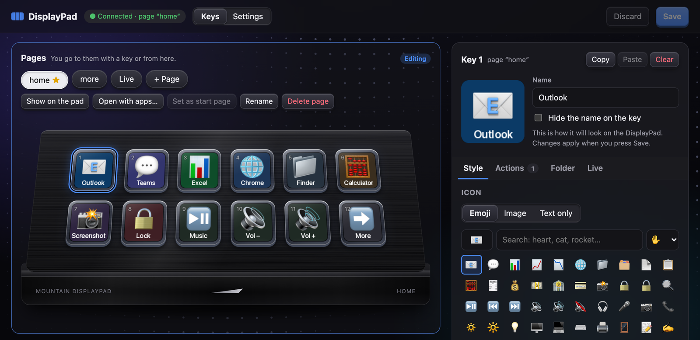
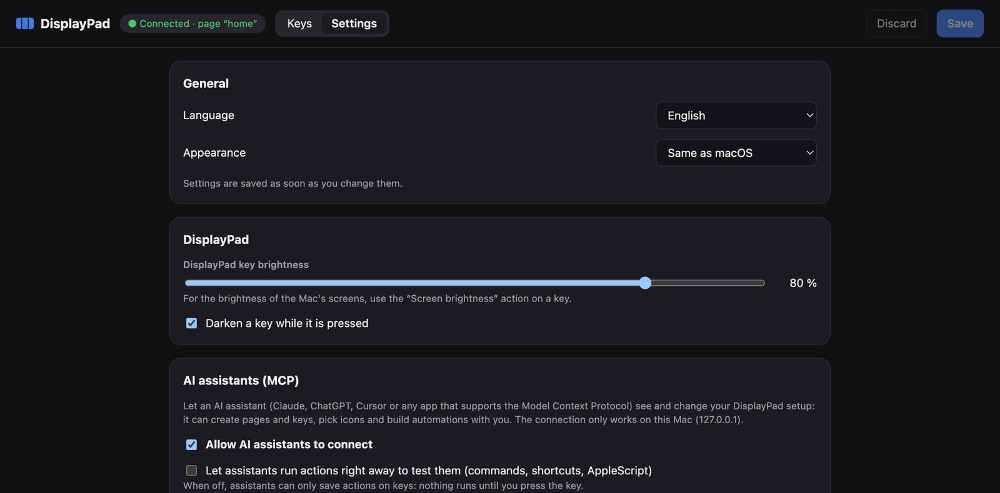

# DisplayPad for Mac

Use the **Mountain DisplayPad** (USB `3282:0009`) on macOS, without BaseCamp: a picture
or animation on each of the 12 keys, several pages, and one or more actions per key
(open apps, keyboard shortcuts, typed text, media keys, macros, scripts, screen brightness).
It runs as a background service and comes with a **visual configurator** in the browser
and an optional **MCP server**, so an AI assistant can help you set up your keys.

[Español](README.es.md)



> **Made with AI.** This project was written with [Claude Code](https://claude.com/claude-code)
> (Anthropic's AI coding assistant), directed and tested by a person on a real DisplayPad.
> See [Made with AI](#made-with-ai).

## Features

- **12 keys with pictures:** emoji, PNG/JPG, animated GIF/WebP/APNG or **Lottie**
  (`.json`, `.lottie`, `.tgs`), with a label, colors and an icon size from 30 % to 200 %.
  You can **hide a key's text** without deleting it.
- **Pictures are never stretched:** keys are square, so a wide or tall picture opens a
  framing editor where you move and zoom it to choose the part the key shows, or show
  it whole. It works the same for GIF and Lottie animations.
- **Folders:** any key can be a folder with 11 more keys, and folders can go inside
  folders. Key 1 in a folder always takes you back.
- **Pages:** as many as you like, with a "back" key and a start page.
- **Actions:** open an app, URL or folder; keyboard shortcuts; type text; play/pause,
  volume and other media keys; shell commands; AppleScript; change page; brightness of the
  Mac's screens (built-in and external over DDC/CI) and of the pad; pauses between actions.
  Several actions per key run in order.
- **Macros:** record what you do with the keyboard and the mouse (keys, clicks, drags,
  scrolling), edit the steps and the delays, and play it from a key once, several times,
  while the key is held, or on and off with each press.
- **Configurator:** drag keys to swap them, drop pictures on them, record shortcuts
  (a single key, or left and right modifiers apart) or pick them on an on-screen keyboard,
  test actions and see their output before you save. English and Spanish, light and dark.
- **AI assistants (MCP):** Claude, Cursor, VS Code or any MCP app on your Mac can read
  and change your setup when you allow it. Off by default.
- **Service:** starts at login, reconnects by itself after sleep or unplugging, and
  reloads the configuration as soon as it changes.

## Requirements

- macOS. Tested on macOS 27.2 on Apple Silicon; Intel Macs should work but are untested.
- [Homebrew](https://brew.sh) and Python 3.11 or newer (`brew install python@3.14`).
- The installer adds `libusb` with Homebrew if it is missing.

## Install

Download the zip from the [latest release](../../releases/latest) and unzip it, or clone
the repository. Then, in Terminal:

```bash
cd displaypad-mac
./install.sh
```

The installer:

- copies the program to `~/Library/Application Support/DisplayPadMac/`;
- sets up its Python environment;
- registers a service that starts at login and restarts if it fails
  (`~/Library/LaunchAgents/com.displaypadmac.agent.plist`);
- adds the **DisplayPad** app to Applications. It opens the configurator.

Run `./install.sh` again to update. Your configuration is kept.

### Permissions

macOS asks for two permissions for **Python**. The installer prints the path of the
`Python.app` that needs them.

- **Input Monitoring:** without it the service cannot switch the DisplayPad on.
- **Accessibility:** needed by the shortcut, text, media key and macro actions.

If macOS doesn't ask, open *System Settings → Privacy & Security*, open the section,
press **+** and choose that `Python.app`. Then press **Restart service** in the
configurator.

### Uninstall

```bash
./uninstall.sh
```

Add `--all` to also delete your configuration and pictures.

## The configurator

Open it with the **DisplayPad** app (Applications, Launchpad or Spotlight), with the
**⚙️ Configure** key on the pad, or with `python -m displaypad_mac configure`.

- **Pages:** tabs at the top. Create, rename and delete pages, mark the start page (★)
  or show a page on the pad.
- **Keys:** click a key to edit it. Drag a key onto another to swap them, or drop a
  picture on it. Copy and paste keys between pages.
- **Folders:** in the key editor, **Make this key a folder**, then **Open folder ›** (or
  double-click the key). Inside, key 1 is a fixed **Back** key and the path at the top
  (`home › Work`) takes you up. To move a key into a folder, drag it and hold it over the
  folder until it opens, then drop it where you want it. Holding it over **Back**, a step
  of the path or a page tab works the same way, and dropping it right on one of them
  puts it in the first free key there. On the pad, pressing a folder key opens it.
- **Appearance:** emoji (with a quick palette), image or text only; label, colors and
  icon size. Tick **Hide the text on the key** to keep the label without drawing it.
  The preview is exactly what the pad draws.
- **Adjust framing:** when you add a picture or animation that isn't square, a window
  opens where you drag it and zoom it (slider, scroll wheel, trackpad pinch, or arrow
  keys and + / −) inside a square the size of the key. **Whole picture** shows all of it
  with the key color around it; **Fill the key** covers the key with its middle. The
  picture keeps its proportions; the original file is not changed, so you can reframe
  it later with **Adjust framing…** in the Image tab.
- **Actions:** several per key, in order. **Record** captures the keys you press: a
  combination like ⌘⇧4, a single key like F13, or a modifier on its own, and it tells left
  from right (Right ⌘ is saved as `rcmd`). **Keyboard…** opens an on-screen keyboard to
  pick keys with the mouse, for the ones the browser keeps for itself (⌘Q, ⌘W, fn) and
  for the numeric keypad. **Hold the keys down while the pad key is held** is for apps
  that react to a held key, like push-to-talk dictation. **▶ Test** runs the actions and shows the output or error of shell commands and
  AppleScript.
- **Macros:** add a **Macro (keyboard and mouse)** action and press **● Record…**. Choose
  what to record (the keyboard, mouse clicks, drags and scrolling, and pointer moves if
  you need them) and press **Start recording**: you have 3 seconds to switch to your app.
  Do what the macro should do, then press any key on the DisplayPad (or **Stop** in the
  configurator). **Edit steps…** lists every step: change keys, buttons, positions and
  waits, add or move steps, or put the same wait everywhere. **Playback** plays it once,
  a number of times, while the pad key is held, or from one press to the next;
  **Delays** keeps the recorded waits, uses one fixed wait, or none. **▶ Test** plays it
  once after 3 seconds, and a banner with **Stop** shows while a macro is playing.
- **Save** (⌘S) checks everything first and tells you which key has a problem. The
  previous file is kept as `config.json.previous`.

If something else changes the configuration while the configurator is open (an AI
assistant, or you editing `config.json`), the page reloads by itself. If you have unsaved
changes, it asks which version to keep.

### Settings

The **Settings** tab applies changes right away:

- **Language:** English (default) or Español.
- **Appearance:** same as macOS, light or dark.
- **DisplayPad:** key brightness, and whether a key darkens while pressed.
- **AI assistants (MCP):** see below.
- **About:** version, service and permission status, and where the configuration and
  log are.



## AI assistants (MCP)

DisplayPad for Mac includes a [Model Context Protocol](https://modelcontextprotocol.io)
server. When you allow it, an AI assistant on your Mac can look at your pages and keys,
create new ones, find the apps you have installed, add pictures and preview the result,
so you can ask things like *"Add a page with my meeting apps"* or *"Make a key that
mutes me in Zoom"*.

1. Open DisplayPad → **Settings** → **AI assistants** and tick **Allow AI assistants to
   connect**.
2. Connect your assistant. The Settings tab shows these snippets with your own paths and
   a **Copy** button.

**Claude Code:**

```bash
claude mcp add --scope user displaypad -- "$HOME/Library/Application Support/DisplayPadMac/displaypad-mcp"
```

**Claude Desktop:** *Settings → Developer → Edit Config*, add the entry and restart Claude.
Replace `YOU` with your macOS user name:

```json
{
  "mcpServers": {
    "displaypad": {
      "command": "/Users/YOU/Library/Application Support/DisplayPadMac/displaypad-mcp"
    }
  }
}
```

**Other apps:**

- Apps that start a local program (stdio): use the `displaypad-mcp` program above. It
  reads the access key by itself.
- Apps that connect to an address (Streamable HTTP): use `http://127.0.0.1:8765/mcp` and
  send the access key from Settings in the header `Authorization: Bearer <key>`.

The server only listens on this Mac, so assistants that run in the cloud and can't reach
`127.0.0.1` won't be able to connect.

| Tool | What it does |
|---|---|
| `get_status` | Connection, current page, permissions |
| `get_reference` | Every key field and action, with examples |
| `get_config`, `list_pages`, `get_key` | Read the setup |
| `set_key`, `clear_key` | Change or clear one key |
| `create_page`, `rename_page`, `delete_page` | Manage pages (links to a renamed or deleted page are updated) |
| `show_page` | Switch the pad to a page |
| `update_settings` | Brightness, press feedback, language, appearance, start page |
| `list_apps` | Installed apps, for "open" actions |
| `upload_image` | Add a picture or animation from a file or base64 |
| `preview_page` | Picture of a page as the pad draws it |
| `test_actions` | Run actions now (only if you allow it, see below) |

**Security**

- The server is off until you turn it on, only listens on `127.0.0.1`, needs the access
  key on every request and rejects requests from web pages.
- **New key** in Settings replaces the access key; connected assistants stop working
  until you give them the new one (the `displaypad-mcp` program picks it up by itself).
- Assistants save actions on keys, and those actions run when you press the key. Only
  connect assistants you trust, and check new keys that run shell commands or AppleScript.
- **Let assistants run actions right away** is off by default. While it is off,
  `test_actions` refuses to run anything.

## Animations (GIF and Lottie)

In **Image** you can upload or drop, besides pictures:

- **Animated GIF**, animated WebP or animated PNG (APNG).
- **Lottie:** `.json`, `.lottie` (dotLottie) or `.tgs` (Telegram stickers).

The DisplayPad doesn't store animations: it shows the last picture it got on each key, so
the service sends the frames one by one. Measured on the pad:

- **About 52 pictures per second in total** (about 18 ms each), shared by the animated
  keys of the page on screen.
- One animated key plays at the file's own speed: up to 50 frames per second for a GIF,
  25 for a Lottie. Two Lottie keys fit at full speed.
- If the animated keys ask for more than the pad can take, frames are skipped: each
  animation keeps its real speed but looks less smooth.
- While you hold an animated key down it stays still and darkened.
- With the pad at its limit the service uses about 4 % CPU.

Uploads are stored in `icons/` as animated WebP, with the shorter side at most 204 px (so
the icon size can go up to 200 %) and the longer one at most 408 px (so a wide animation
can still be framed), and at most 180 frames (frames in between are dropped if there are more).
Lottie files are drawn with rlottie at 25 frames per second. Some After Effects features
(expressions, effects, text layers) may not be drawn; if a Lottie comes out without
motion the configurator tells you: export it as a GIF instead.

## Editing the configuration by hand

You can also edit `~/Library/Application Support/DisplayPadMac/config.json`. **It is
reloaded as soon as you save it.** Keys are numbered 1 to 12: 1-6 on the top row and
7-12 on the bottom row. [`config.example.json`](config.example.json) is a full example.

```json
{
  "language": "en",
  "theme": "system",
  "brightness": 80,
  "press_feedback": true,
  "mcp": {"enabled": false, "allow_run": false},
  "start_page": "home",
  "pages": {
    "home": {
      "keys": {
        "1": {"emoji": "📧", "label": "Outlook", "color": "#0B3A66",
              "action": {"type": "open", "target": "Microsoft Outlook"}},
        "2": {"image": "icons/logo.png", "label": "Capture", "hide_label": true,
              "actions": [{"type": "shortcut", "keys": "cmd+shift+4"}]}
      }
    }
  }
}
```

**Key fields** (all optional)

| Field | Meaning |
|---|---|
| `emoji` | An emoji, drawn in color |
| `image` | Path to a PNG, JPG, GIF or animated WebP, relative to the configuration folder (put pictures in `icons/`). Lottie files are converted when you upload them in the configurator |
| `crop` | Images only. `[left, top, right, bottom]`: the part of the picture the key shows, as fractions of its width and height (`[0.25, 0, 0.75, 1]` is the middle square of a 2:1 picture). Values below 0 or above 1 zoom out and show the key color there (`[0, -0.5, 1, 1.5]` shows a 2:1 picture whole). Never stretched: if the area isn't square in pixels, the picture is centred in it. Without `crop`, the middle of the picture covers the key, or, with a label or `fill: false`, the whole picture is shown. The configurator writes it for you |
| `fill` | Images only. `true` (default) makes a picture cover the whole key when no label is drawn; `false` keeps a margin |
| `icon_scale` | Size of the emoji or picture in %, 30 to 200 (100 is normal) |
| `label` | Text. It shrinks and wraps to fit |
| `hide_label` | `true` keeps the label without drawing it |
| `color` | Background color, e.g. `#1C1C24` |
| `text_color` | Text color |
| `action` / `actions` | One action, or a list run in order |
| `folder` | Makes the key a folder: `{"keys": {"2": {...}, "3": {...}}}`, with keys 2 to 12 (key 1 is its Back key). A folder can hold folders. Its own actions, if any, run before it opens |

**Actions**

| `type` | Fields | Example |
|---|---|---|
| `open` | `target`: app, URL or folder | `"Microsoft Excel"`, `"https://..."`, `"~/Documents"` |
| `shortcut` | `keys`; `hold`: `true` keeps them down while the pad key is held | `"cmd+shift+4"`, `"f5"`, `"rcmd"`, `"ctrl+rshift"` |
| `text` | `text` (`\n` presses Return) | `"Best regards,\n"` |
| `media` | `key` | `play_pause`, `next`, `previous`, `volume_up`, `volume_down`, `mute`, `brightness_up`, `brightness_down` |
| `shell` | `command` | `"say done"` |
| `applescript` | `script` | `"display notification \"Hello\""` |
| `page` | `page`: a page name, or `back` | `"more"` |
| `screen_brightness` | `value`: a level or `"+10"` / `"-10"`; `display`: `all`, `builtin` or `external` | `{"value": "-10", "display": "all"}` |
| `brightness` | `value`: the pad's own brightness, a level or `"+10"` / `"-10"` | `"+20"` |
| `delay` | `ms`: wait between actions | `250` |
| `macro` | `steps`; `play`: `once`, `repeat` (with `times`), `while_held` or `toggle`; `delays`: `recorded`, `fixed` (with `delay_ms`) or `none` | see below |
| `configurator` | none: opens the configurator | |

`screen_brightness` changes the MacBook screen (like F1/F2) and external monitors over
DDC/CI (turn DDC/CI on in the monitor's menu if it doesn't respond).

Shortcut modifiers: `cmd`, `shift`, `ctrl`, `alt`/`option`, `fn` (the left keys) and
`rcmd`, `rshift`, `rctrl`, `ralt` (the right ones). Keys: letters, numbers, `f1` to `f20`,
`return`, `tab`, `space`, `esc`, `delete`, `forwarddelete`, arrows (`up`, `down`, `left`,
`right`), `home`, `end`, `pageup`, `pagedown`, `help`, `section` (§), the numeric keypad
(`kp0` to `kp9`, `kpdecimal`, `kpplus`, `kpminus`, `kpmultiply`, `kpdivide`, `kpequals`,
`kpenter`, `kpclear`) and punctuation.

A shortcut can also be a single key (`"f13"`) or modifiers alone (`"rcmd"`), for apps
that start listening when you press one key. Add `"hold": true` to keep the keys down for
as long as you hold the pad key; they come up when you let go (after 10 minutes at most).
Without it, the keys are pressed and let go at once.

```json
{"type": "shortcut", "keys": "rcmd", "hold": true}
```

A macro is a list of steps played in order. The configurator records them for you, but
you can also write them:

| Step | Fields |
|---|---|
| `keys` | `keys`: a whole shortcut, pressed and let go (`"cmd+c"`) |
| `key_down`, `key_up` | `key`: one key or modifier (`"rcmd"`, `"a"`) |
| `text` | `text`: typed as is |
| `click` | `button` (`left`, `right`, `middle`, `back`, `forward`), `count` (2 is a double click), `x`, `y` |
| `mouse_down`, `mouse_up` | `button`, `x`, `y` |
| `move` | `x`, `y` (it drags while a button is down) |
| `scroll` | `dy`, `dx` in pixels (positive `dy` scrolls up), `x`, `y` |
| `wait` | `ms` |

`x` and `y` are screen points from the top-left corner of the main display; leave them
out to use wherever the pointer is. Pressing the key again while a macro plays does
nothing, except to stop a `toggle` one. Any key or button a macro holds is let go when it
ends or is stopped.

```json
{"type": "macro", "play": "repeat", "times": 3, "steps": [
  {"do": "keys", "keys": "cmd+a"}, {"do": "wait", "ms": 100},
  {"do": "text", "text": "Hello"}, {"do": "click", "x": 640, "y": 400}]}
```

## Useful commands

Run them from the installed folder:

```bash
cd ~/Library/Application\ Support/DisplayPadMac
```

| To… | Command |
|---|---|
| Open the configurator | `.venv/bin/python -m displaypad_mac configure` |
| Draw the pages as PNG files, without the device | `.venv/bin/python -m displaypad_mac preview --config config.json` |
| Check and request permissions | `.venv/bin/python -m displaypad_mac permissions` |
| Restart the service | `launchctl kickstart -k gui/$(id -u)/com.displaypadmac.agent` |
| Follow the log | `tail -f ~/Library/Logs/DisplayPadMac.log` |
| Test the hardware (stop the service first) | `.venv/bin/python -m displaypad_mac test` |

## Troubleshooting

- **`Cannot open DisplayPad IF0: kIOReturnNotPermitted`** in the log: Python is missing
  the Input Monitoring permission.
- **Shortcuts, text or media keys do nothing:** Python is missing the Accessibility
  permission.
- **It stopped working after `brew upgrade`:** Homebrew replaced the Python binary. Run
  `./install.sh` again and give the permissions to the new `Python.app`.
- **Keys stay black after the Mac sleeps or the pad is unplugged:** the service
  reconnects by itself in about 2 seconds. If it doesn't, restart it.
- **The DisplayPad app says the service is not responding:** check the log. If another
  program uses port 8765 the configurator can't start (the pad keeps working).
- **Screen − / + doesn't change the external monitor:** turn DDC/CI on in the monitor's
  menu. Some USB-C adapters and docks don't pass DDC through.
- **An animation stutters:** the animated keys on that page ask for more than the
  ≈ 52 pictures per second the pad accepts. Use fewer animated keys on that page, or GIFs
  with fewer frames per second.
- **An AI assistant can't connect:** check that **Allow AI assistants to connect** is on
  and that the service is running. A `401` means the access key is wrong or was replaced.
- **`Another DisplayPadMac instance is already running`:** only one program can use the
  DisplayPad at a time. Stop the service before using `test`.

## How it works

The Windows installer (BaseCamp 1.9.10) contains **no kernel driver**: no `.sys` or
`.inf` files. It is an Electron/.NET app whose `DisplayPadSDK.dll` talks to the device
through the standard Windows HID API. macOS already sees the DisplayPad as a HID
device, so all that was missing was a program that talks to it.

The device has three USB interfaces:

| Interface | What it is | How it is used on macOS |
|---|---|---|
| IF0 | HID keyboard (macOS drives it) | IOKit, shared open, one `SET_REPORT` |
| IF1 | Image data (no macOS driver) | claimed with `libusb`; OUT endpoint `0x02` |
| IF3 | Vendor HID `0xFF00`, 64 bytes | `hidapi`: commands, acknowledgements and key presses |

**Why the Linux driver hangs on a Mac:** the firmware ignores every command on IF3 until
it gets output report 3 = `[0x03, 0x01]` on IF0 ("event mode"). On Linux it is sent by
detaching IF0 from the kernel, which needs root on macOS. Here it is sent by opening IF0
in shared mode with IOKit, which needs no root, only the Input Monitoring permission.

Each key picture is one 102 × 102 BGR transfer of 31,744 bytes on IF1, about 18 ms.

## Made with AI

This project was written with **Claude Code**, Anthropic's AI coding assistant: the
driver, the service, the configurator, the MCP server, the installer and this README.
A person directed the work, decided what to build and tested every feature on a real
DisplayPad on macOS. Review the code as you would any other open-source project before
you rely on it.

## Credits

- USB protocol and image upload sequence:
  [oss-mountain-displaypad](https://github.com/AnnikenYT/oss-mountain-displaypad) by
  AnnikenToGo (MIT). Reimplemented in Python in `displaypad_mac/driver.py`.
- How the pad is switched on was first understood from
  [BaseCamp-Linux](https://github.com/ramisotti13-eng/BaseCamp-Linux) (consulted only,
  no code copied).
- Lottie animations: [rlottie](https://github.com/Samsung/rlottie) through
  [rlottie-python](https://github.com/laggykiller/rlottie-python) (LGPL 2.1).
- The macOS part (IOKit activation, claiming IF1 with libusb, the service, actions,
  screen brightness, configurator and MCP server) is new and was verified on the hardware.

Details and license texts: [THIRD_PARTY_NOTICES.md](THIRD_PARTY_NOTICES.md).

## License

[MIT](LICENSE). Not affiliated with, endorsed by or supported by Mountain or 360 Service
Agency GmbH. Mountain and DisplayPad are trademarks of their owners.
